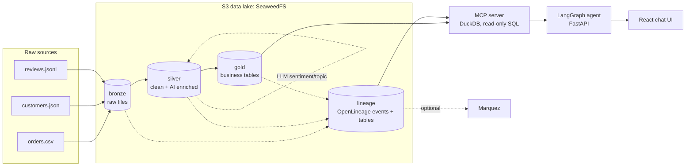

# Tech Summit demo: Devin + Parser AI

A monorepo with a medallion data pipeline, an S3 data lake with full data lineage, an MCP server, and a LangGraph chatbot with a web UI. One command starts everything:

```bash
cp .env.example .env   # optional: add an LLM key
docker compose up --build
```

| URL | What |
|---|---|
| http://localhost:3000 | Chat UI, lineage graph, data quality report |
| http://localhost:8080/docs | Agent API (FastAPI) |
| http://localhost:8000/mcp | MCP server (streamable HTTP) |
| http://localhost:8333 | SeaweedFS S3 endpoint (the data lake) |

## Architecture



| Layer | Content | Code |
|---|---|---|
| Sources | Messy sample data: duplicates, mixed date and price formats, bad rows, free-text reviews | `scripts/generate_sources.py`, `data/sources/` |
| Bronze | Raw files landed unchanged under `<source>/ingested_at=<ts>/` | `pipeline/src/pipeline/bronze.py` |
| Silver | Deduplicated, typed, normalised, invalid rows dropped; reviews enriched with sentiment and topic by an LLM | `silver.py`, `enrich.py` |
| Gold | `sales`, `customer_360`, `product_performance`, `daily_revenue`, `review_insights` | `gold.py` |
| MCP | Tools: `list_tables`, `describe_table`, `query`, `get_lineage`, `get_column_lineage`, `get_data_quality` | `mcp-server/` |
| Agent | LangGraph tool-calling agent over the MCP tools, served by FastAPI | `agent/` |
| UI | Chat, lineage graph with column tracing, data quality report | `ui/` |

## Data lineage

Every number in a gold table can be traced back to the raw file it came from:

- **Row level:** every silver and gold row has `_run_id` and `_processed_at`. Silver rows also have `_source_uri`, the exact bronze object they were read from.
- **Job level:** each step (3 bronze, 3 silver, 5 gold) emits OpenLineage `START`/`COMPLETE`/`FAIL` events with schema, column lineage and row count facets. Raw events are stored at `s3://lineage/events/run_id=<id>/events.jsonl`.
- **Reporting tables** in the `lineage` bucket, queryable via MCP/SQL:

| Table | Content |
|---|---|
| `lineage_runs` | One row per pipeline run |
| `lineage_jobs` | One row per job: inputs, outputs, rows in/out/dropped, status, duration |
| `lineage_edges` | Dataset to dataset edges |
| `lineage_columns` | Column to column edges with the transformation applied |
| `data_quality` | Rows dropped per rule (e.g. `invalid_order_date`, `non_positive_quantity`) |

Lineage history is appended, so you can compare runs. Ask the chatbot "Where does customer revenue come from?" or open the **Lineage** tab and click a column to trace it to its source.

**Marquez (optional):** to also see the lineage in the reference OpenLineage UI:

```bash
OPENLINEAGE_URL=http://marquez:5000 docker compose --profile marquez up --build
```

Then open http://localhost:3001.

## LLM configuration

Set these in `.env`:

| Variable | Values |
|---|---|
| `LLM_PROVIDER` | `none` (default), `openai`, `anthropic` |
| `LLM_MODEL` | e.g. `gpt-4o-mini`, `claude-sonnet-4-5` |
| `OPENAI_API_KEY` / `ANTHROPIC_API_KEY` | Your key |

With `LLM_PROVIDER=none` everything still runs: review enrichment uses keyword rules (rows are tagged `method=heuristic`), and the chatbot answers a fixed set of questions (revenue, products, customers, complaints, lineage, data quality) through the same MCP tools.

## Local development

```bash
# data lake
docker compose up -d seaweedfs

# pipeline
cd pipeline && python -m venv .venv && .venv/bin/pip install -r requirements-dev.txt
PYTHONPATH=src .venv/bin/python -m pipeline.run
.venv/bin/pytest -q

# MCP server
cd mcp-server && python -m venv .venv && .venv/bin/pip install -r requirements.txt pytest
.venv/bin/python -m datalake_mcp.server     # :8000
.venv/bin/pytest -q

# agent
cd agent && python -m venv .venv && .venv/bin/pip install -r requirements.txt
.venv/bin/uvicorn app.main:app --port 8080

# UI (proxies /api to :8080)
cd ui && npm install && npm run dev        # :5173
```

Rerun the pipeline in Compose with `docker compose run --rm pipeline`. Regenerate the sample sources with `python scripts/generate_sources.py`.

## Repository layout

```
data/sources/        sample raw files
infra/seaweedfs/     S3 identities (demo credentials: admin for the pipeline, read-only for MCP)
pipeline/            bronze, silver, gold, lineage
mcp-server/          MCP server over the lake (DuckDB)
agent/               LangGraph agent + FastAPI
ui/                  React (Vite) chat UI, served by nginx
docker-compose.yml   the whole stack
```
